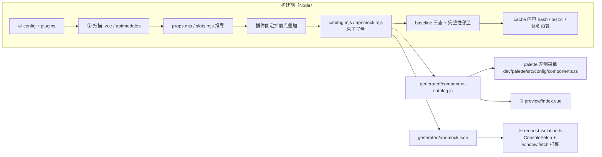
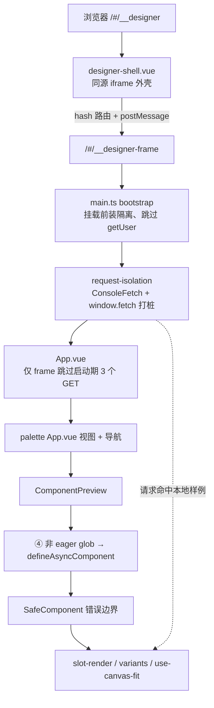
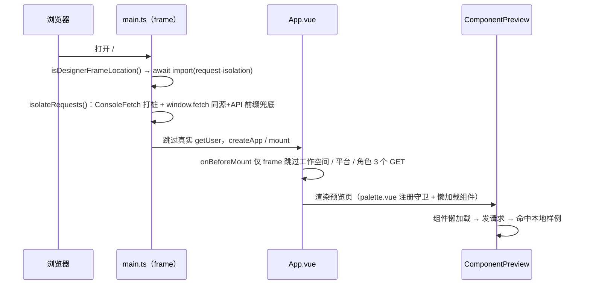

# Palette（主题色板 / 组件预览）架构与维护指南

本文是 palette 的**上位文档**：讲清分层、数据流、扩展点、Skills 工作流与隔离边界。
色板视图自身的交互与数据口径见 [`dev/palette/README.md`](../dev/palette/README.md)，
生成器的 CLI / 插件参数见 [`scripts/component-preview/README.md`](../scripts/component-preview/README.md)，
三个操作规范的完整原文见 [`.agents/skills/`](../.agents/skills/)。本文不复制它们的细节，只说明它们如何拼在一起。

## 1. 它是什么

一个供**设计师与开发侧 AI agent**使用的内部工具：查看主题令牌、预览全仓业务组件形态，并在组件 props / slots 变化后同步预览样例。

| 运行方式                       | 入口                                            | 能力                                                                             |
| ------------------------------ | ----------------------------------------------- | -------------------------------------------------------------------------------- |
| 内嵌主应用（推荐用于组件预览） | `pnpm dev` 后打开 `/#/__designer`               | 四个视图都可用；组件预览在同源 iframe 中渲染真实业务组件                         |
| 独立预览                       | `pnpm theme:designer` → `http://localhost:5300` | 颜色 / 圆角 / 可视化完整；组件预览视图提示「需在主应用打开」（缺少主应用上下文） |

`dev/palette/src/App.vue` 通过 `hasPaletteRouter` 与 `#component-preview` slot 兼容两种宿主：
有 slot 时渲染主应用传入的 `ComponentPreview`（`src/pages/designer/palette.vue`），没有时显示 `ComponentPage.vue` 的提示。

四个视图（`dev/palette/src/router/index.ts`）：`component`（组件预览）、`color`（色阶 / 语义色）、`radius`（圆角字典）、`viz`（可视化字典）。
颜色 / 圆角 / 可视化只读解析 `src/styles/theme/tokens/*.css`，工具本身**不改 token**（改色走 `theme-designer` skill）。

## 2. 分层与命名

构建期部分统一称**构建期基建层（Generation Pipeline）**，内部再拆「声明配置」与「解析产物」两件事：
`component-preview.config.mjs` 与 `plugins/*.mjs` 提供扫描范围、id 规则与业务域扩展点（以可执行模块形式），
`internal/*.mjs` 覆盖类型推导、清单组装、写盘、缓存、基线与完整性守卫。

| 层                            | 主要位置                                                                                                                                          | 职责                                                                                 | 边界 / 产物                                           |
| ----------------------------- | ------------------------------------------------------------------------------------------------------------------------------------------------- | ------------------------------------------------------------------------------------ | ----------------------------------------------------- |
| ① 声明配置层                  | `scripts/component-preview/component-preview.config.mjs`、`plugins/*.mjs`                                                                         | 扫描范围、id 规则、占位值、收录门槛、业务域手写样例与扩展点                          | 只在 Node 构建期执行；函数样例会被序列化进产物        |
| ② 构建期基建层（解析 + 产物） | `scripts/component-preview/internal/*`、`index.mjs`、`scripts/designer-bundle-budget.mjs`                                                         | 扫描 / 类型推导 / 插件叠加 / 组装 / 原子写盘 / 缓存 / 基线 diff / CI 校验 / 体积预算 | 产出 `src/pages/designer/generated/*`；不进生产运行时 |
| ③ 运行渲染层                  | `dev/palette/src/*`、`src/pages/designer/preview/*`                                                                                               | 导航与视图、组件懒加载、真实态 / 结构视图、变体与组件族、画布适配、错误兜底          | 浏览器运行时；只读产物，不解析源码                    |
| ④ 隔离安全层                  | `src/pages/designer/designer-shell.vue`、`src/main.ts`、`src/App.vue`、`preview/{designer-route,request-isolation,fetch-guard,safe-component}.ts` | iframe realm、挂载前请求打桩、原生 fetch 兜底、postMessage 校验、错误边界            | 把「渲染真实业务组件」限制在可控范围内                |
| ⑤ 工作流层                    | `.agents/skills/*`（副本 `.codebuddy/skills/*`）                                                                                                  | 组件样例同步、设计师改样例、主题改色三个规范                                         | 约束人与 agent 的操作顺序与红线                       |

依赖方向严格自下而上：③④⑤ 都只消费 ② 的产物，不反向依赖生成器源码；① 不参与浏览器运行。

## 3. 端到端数据流





关键契约：

- **组件 id** = 相对 `componentIdBase` 的路径去掉 `.vue`（可由 `componentIdStripPrefixes` 省略前缀）。生成端 `resolveComponentId` 与消费端 `catalog.ts:resolveComponentId` 必须一致，否则「清单有、预览静默跳过」，靠 `unmatchedIds` 告警发现。
- **产物** `component-catalog.js`（44 条清单，约 30KB）、`api-mock.json`（60 个接口样例，约 28KB）都不入 git，但是 `build` / `dev` 的硬前置；`component-catalog.d.ts` 手工维护，是渲染层的类型契约。
- **状态** `new` / `changed` / `stable` 来自基线签名（覆盖前的 `analyzedProps` + slots hash），`removedIds` 独立记录。

## 4. 基本功能

**色板 / 圆角 / 可视化**：分组浏览、token 复制（实际值与 `var()` 两种）、按 CIEDE2000 的色值搜索与建议、专注模式（`?focus=`）、语义控件仿制小样。详见 [`dev/palette/README.md`](../dev/palette/README.md)。

**组件预览**（本文重点）：

| 能力               | 实现位置                                 | 说明                                                                                                                 |
| ------------------ | ---------------------------------------- | -------------------------------------------------------------------------------------------------------------------- |
| 组件导航与搜索     | `dev/palette/src/config/components.ts`   | 直接读同一份 `componentCatalog`，按 usage 排序、显示 SLOT / 状态 Tag                                                 |
| 结构视图 / 真实态  | `preview/index.vue`、`slot-render.ts`    | 结构视图用占位块展示可替换区域；真实态用组件自带 fallback 或插件样例                                                 |
| 变体 / 组件族      | `variants.ts`、`variant-card.vue`        | 内容量、props 不同导致形态不同时给切换按钮；组件族是 wrapper + 变体单元                                              |
| 弹层与布局壳       | `safe-component.ts`、`use-canvas-fit.ts` | `visibilityProp` 控制 Dialog / Sideslider；`containerWidth` / `fillHeight` / `heightProp` 等元信息给组件一个稳定参照 |
| 接口样例           | `request-isolation.ts`、`fetch-guard.ts` | 组件照常发请求，按 `METHOD url模板` 命中本地样例，不触达后端                                                         |
| 画布适配与卸载清理 | `use-canvas-fit.ts`、`preview/index.vue` | ResizeObserver 测量可用高度；卸载时还原 appID 与观察者                                                                    |

收录标准是「有结构、有状态、可交互」：`ignoreIds` 排除图标 / 空壳 / 远程依赖，`minUsageToInclude` 过滤低频引用，`usageExcept` 留白名单；`warning.patterns` 命中 iframe、`route.params` 等会给预览提示。

## 5. 构建期基建层

### 5.1 流水线

`pnpm build` / `pnpm dev` 前置执行 `node scripts/component-preview/index.mjs`（全量扫描约 1.6s，672 个源文件 / 210 个组件 `.vue` / 54 个 API 模块）：

1. 按 `componentGlobs` 扫描，过滤 `ignoreIds` 与引用数不足项；
2. `props.mjs` 从 `defineProps` / `defineModel` 推导占位，`slots.mjs` 提取 slot 结构（`maxDepth` 防自引用递归）；
3. `plugins/*.mjs` 按固定扩展点覆写 / 增强；
4. `catalog.mjs` 组装条目、`api-mock.mjs` 从接口类型生成样例，两者都走 `atomic-write.mjs`（同目录临时文件 + rename）；
5. `cache.mjs` 用「生成器模块 + 配置 + 全部引用源 + 基线」的**内容 hash**（sha256）做签名，命中即跳过重算；
6. `baseline.mjs` 对比签名，输出三态与 removedIds。

### 5.2 可靠性护栏

| 护栏                         | 作用                                                                                                                                                                                                                     |
| ---------------------------- | ------------------------------------------------------------------------------------------------------------------------------------------------------------------------------------------------------------------------ |
| 内容 hash 缓存               | mtime 在 CI checkout 会全量刷新、在可复现构建里可能被归一化；内容 + 路径签名两头都稳                                                                                                                                     |
| 原子写 + 失败保留旧产物      | 生成失败不再写空清单兜底，只置 `exitCode = 1` 让 `&&` 短路，避免「构建成功但预览空白」                                                                                                                                   |
| 基线完整性守卫               | 条目数相对基线骤降 >10% 时拒绝 `--prune`，防止 glob 改错把基线清空                                                                                                                                                       |
| `pnpm test:ci`               | 串联生成器、业务单测、`pnpm test:scripts`（279 个脚本用例）与 `--check`；变更样例必须全绿                                                                                                                                |
| `designerBundleBudgetPlugin` | 构建时统计 designer / `dev/palette` 入口及静态依赖的 gzip 体积，排除 SPA 主入口与按需 chunk；默认 1MiB 只告警（`BK_DESIGNER_BUNDLE_STRICT=1` 可令构建失败，`BK_DESIGNER_BUNDLE_BUDGET_KB` 可调），专防 `eager glob` 回归 |

当前实测：`[designer-bundle] 静态依赖 41.9 KiB / 预算 1024 KiB（6 个 chunk）`。
主入口 `index-*.js` 约 11MB（gzip 3.19MB）是**所有页面共享**，所有页面都要下载，不算设计器带来的增量，因此预算口径排除 `isEntry` chunk；要真正减小设计器首屏，只能把它拆成独立构建。

### 5.3 CLI 速查

| 命令                                       | 作用                                   |
| ------------------------------------------ | -------------------------------------- |
| `node scripts/component-preview/index.mjs` | 日常生成                               |
| `... --check`                              | 只读 diff / status，不写产物           |
| `... --baseline`                           | 首次建全量基线                         |
| `... --baseline --only <id>`               | 增量确认单个组件（日常唯一允许的写回） |
| `... --baseline --prune`                   | 清理 removed（受完整性守卫约束）       |
| `... --baseline --force --yes`             | 非首次全量写回，会清掉所有待确认，慎用 |

## 6. 运行渲染层

### 6.1 路由与按需加载

`src/modules/router.ts` 注册两条懒加载路由：`designer`（外壳 `/#/__designer`）与 `designerFrame`（iframe 内 `/#/__designer-frame`，`beforeEnter` 要求 `window.self !== window.top`）。生产构建同样会打进这两个 chunk。

frame 页的导航约束由 frame 路由组件 `src/pages/designer/palette.vue` 声明：挂载时用 `useRouter().beforeEach` 注册守卫，只放行 `designerFrame`（`isFrameRoute`），卸载时移除，避免「无 user + 请求打桩」的状态被带进业务页。守卫挂在 `palette.vue` 而非 `preview/index.vue`，因为后者只在 `viewMode === 'component'` 时才经 `#component-preview` slot 渲染，外壳带 `?view=color` 等进入时它根本不挂载，守卫会漏注册。业务 `src/modules/router.ts` 与 `App.vue` 都不含设计器判断；顶层直接打开 frame URL 由 `beforeEnter` 重定向回外壳。

`preview/index.vue` 用**非 eager** `import.meta.glob` 覆盖 `src/components/**` 与 `src/pages/**/components/**`：命中 210 个 `.vue`，但清单只收录 44 个。`catalog.ts:buildComponentMap` 把每个 loader 包成 `defineAsyncComponent`（`suspensible: false`、loading / 错误兜底、外层有状态组件保证宿主拿到实例），因此**只有当前渲染的组件才下载对应 chunk**。外层包装让 `SafeComponent` 与 `h(component, props)` 无需关心异步。

### 6.2 组件渲染链

```text
buildComponentMap（id → Component）
  → SafeComponent（onErrorCaptured 错误边界、Form 上下文、v-model 写回、布局壳）
  → slot-render（占位块 / 样例 / omit / guardedSlots 分支）
  → variants（变体优先于条目本身的 props 与 slotOverrides）
  → use-canvas-fit（ResizeObserver 回填可用高度，卸载 disconnect）
```

`SafeComponent` 的价值在于：预览的是**真实业务组件**，组件可能读 store、发请求、弹窗、用 `v-html`；任一层出错都收敛成卡片内的错误提示，而不是拖垮整个主应用。

### 6.3 契约护栏

- `scripts/test/component-preview-consumer.test.mjs`：`ComponentCatalogEntry` 全量 key − `NOT_PICKED` 必须是 `previewItems` pick 字段的子集——新增产物字段却忘了渲染层消费会直接红。
- `test/component-preview-catalog-id.test.ts`：id 解析与 loader 行为（不加载不下载、缺默认导出有可读提示）。
- `preview/index.vue` 的 `unmatchedIds`：清单里有但 glob 没匹配到的组件在页面顶部告警（**不加 DEV 判断**，生产同样踩得到，排查成本高于一条告警）。

## 7. 可扩展性

### 7.1 声明配置层的固定扩展点

`plugins/*.mjs`（17 个业务域插件）导出一组固定扩展点，生成器按需消费；完整参数表见 [`scripts/component-preview/README.md`](../scripts/component-preview/README.md)。

| 扩展点                                                       | 用途                                               |
| ------------------------------------------------------------ | -------------------------------------------------- |
| `propOverrides`                                              | 整字段覆写 props 样例（手写主力，目前 9 个组件）   |
| `slotOverrides` / `slotCombos`                               | slot 样例覆写；多 slot 组合态                      |
| `previewVariants` / `componentFamily`                        | 同一组件多形态；wrapper + 变体单元                 |
| `enumOverrides` / `transformArrayItems` / `transformSamples` | 枚举候选、数组与接口样例变换                       |
| `disabledFn`                                                 | 禁用某条样例（**函数体会被序列化进产物**，见 9.3） |
| `containerWidth` / `fillHeight` / `fillWidth` / `heightProp` | 预览容器布局元信息                                 |
| `visibilityProp` / `needsFormContext`                        | 弹层显隐、表单上下文                               |

### 7.2 四类常见扩展

1. **新增组件**：只要在 `componentGlobs` 覆盖范围内且达到收录门槛，会自动推导样例并进入 `new`；推导接不住时才补 `plugins` 手写样例，优先复用推导。
2. **新增接口样例**：`src/api/modules/*.ts` 的类型声明被 `api-mock.mjs` 推导，`METHOD url模板` 自动进样例表；需要真实语义数据时用 `transformSamples`。
3. **新增色板视图 / 分组**：改 `dev/palette/src/router/index.ts` 的 `PaletteView` 与 `pages/`，以及 token CSS 的 `@group` / `@note` / `@endgroup` 注释约定（见 `theme-designer` skill）。
4. **新增扩展点**：改生成器读取逻辑 + `component-catalog.d.ts` + 渲染层 pick + consumer 护栏测试，四者同步；缺一会在 `pnpm test:ci` 暴露。

### 7.3 扩展时的护栏清单

- 新增 `src/**/components` 目录时，同步 `preview/index.vue` 的两条 glob 字面量（Vite 不支持动态 glob），否则 `unmatchedIds` 会报警。
- 手改样例后跑 `pnpm test:scripts`（跨字段引用断言，如 `tab.active ∈ tabs[].name`）。
- 别把 `import.meta.glob` 改回 `eager`：体积预算与 `designer-bundle-budget.test.mjs` 会拦住。
- 改主题 / 组件类型后按第 8 节流程同步基线，不要直接编辑 `component-baseline.json`。

### 7.4 已知局限

非枚举的具体数组只推导 1 条（想看多条需手写 `propOverrides`）；完整性守卫是启发式（>10% 骤降才拦截，小规模减员仍可能静默漏过）；基线签名取覆盖前，能抓「组件结构变了」但抓不到「手写样例写错」，后者靠跨字段测试兜底。

## 8. Skills 与工作流

三个 skill 都放在 `.agents/skills/`，并在 `.codebuddy/skills/` 有同名副本，**改动必须两处同步**。

| Skill                                                                                 | 面向         | 触发                                                  | 能改什么 / 红线                                                                                                                             |
| ------------------------------------------------------------------------------------- | ------------ | ----------------------------------------------------- | ------------------------------------------------------------------------------------------------------------------------------------------- |
| [`component-preview-sync`](../.agents/skills/component-preview-sync/SKILL.md)         | 开发侧 agent | 组件 props / slots / 类型文件变化、增删组件、样例过期 | `--check` 看 diff → 判断是否需改插件 → `--baseline --only <id>` 确认；禁止 `--force --yes` 全量写回、禁止手改基线、确认须附证据             |
| [`component-preview-designer`](../.agents/skills/component-preview-designer/SKILL.md) | 设计侧 agent | 设计师觉得样例不合适                                  | 可直接改 `plugins/*.mjs` 的样例并重新生成；不碰基线、不碰 Tag 语义；`componentFamily` / `enumOverrides` / `disabledFn` 等结构性改动交给开发 |
| [`theme-designer`](../.agents/skills/theme-designer/SKILL.md)                         | 设计侧 agent | 改颜色 / token / 主色                                 | 色值只写 `tokens/color.css`；palette 是**只读预览**，不在工具里改 token；改完刷新色板对比                                                   |

标准流程（`component-preview-sync`）：

```text
改组件类型 → node scripts/component-preview/index.mjs --check
          → 判断纯推导 / 手写样例 / new / removedIds / info
          → （按需）改 plugins/*.mjs
          → node scripts/component-preview/index.mjs --baseline --only <id>（附证据）
          → pnpm test:scripts
```

预览页 header 的「新增 / 示例待更新」Tag 是**组件结构变了**的信号，不是「样例内容不对」的提示；基线损坏时 `--check` 会报「基线读取异常」，此时先停手。

## 9. 隔离与安全层

### 9.1 为什么需要边界

组件预览渲染的是真实业务组件：它们会读 Pinia、发 `ConsoleFetch` 请求、弹 Dialog、用第三方库加载资源。若不隔离，预览页会把缺上下文的 4xx/5xx、全局错误提示甚至真实写请求带进主应用会话。因此边界不是「加一层 iframe」就完事，而是**挂载前的时序 + 请求出口 + 渲染兜底**三件事。

### 9.2 三层边界

| 边界                 | 实现                                                                                                | 说明                                                                                                                                                                                                                                                                                                                          |
| -------------------- | --------------------------------------------------------------------------------------------------- | ----------------------------------------------------------------------------------------------------------------------------------------------------------------------------------------------------------------------------------------------------------------------------------------------------------------------------- |
| ① iframe realm       | `designer-shell.vue`、`palette.vue`、`designer-route.ts`                                            | 父页是外壳，frame 内是完整 App（独立 Pinia / 拦截器 / 模块实例）；`beforeEnter` 阻止 frame 被顶层直接打开；frame 路由组件 `palette.vue` 注册的 `beforeEach` 只放行 `designerFrame`，随组件卸载移除；同源 hash 用 `postMessage` 同步，父页校验 `origin === location.origin`、`source === iframe.contentWindow`、`type === 'palette-query-sync'` |
| ② 请求隔离（挂载前） | `designer-route.ts` → `main.ts:bootstrap()` → `request-isolation.ts` + `fetch-guard.ts` → `App.vue` | 见下方时序；`ConsoleFetch.prototype.request` 打桩 + 原生 `window.fetch` 兜底（**只拦同源 + API 前缀**，跨源与同源静态资源放行）；命中 `api-mock.json` 返回 `structuredClone(sample)`，未命中返回 `[]`                                                                                                                                   |
| ③ 渲染兜底           | `safe-component.ts`、`catalog.ts`、`preview/index.vue` 的 `unmatchedIds`                            | `onErrorCaptured` 错误边界、异步组件 loading / 错误组件、缺默认导出的可读提示、glob 与清单 mismatch 告警；卸载时还原 appID、ResizeObserver 与 message 监听（请求桩由 `main.ts` 全程持有、故意不还原）                                                                                                                  |



时序是最关键的一环：`getUser` 和 `App.vue` 的启动期请求都早于任何子组件 setup，把打桩放在预览页组件里已经来不及，所以必须在 `main.ts` 挂载前完成；动态 import 保证 `api-mock.json` 只在 frame 里下载，不进业务首屏。设计器**外壳**（`/#/__designer`）保留完整真实启动期请求（`getUser` + 工作空间 / 平台 / 角色 3 个 GET）：它渲染完整 header（logo / 用户菜单），且 `onBeforeMount` 只在 App 挂载时跑一次，若外壳也跳过，点 logo 或浏览器前进/后退回到业务页后这些请求永不补发（标题不更新、`hasPlatformRole` 恒 false）。

### 9.3 构建期安全

- **产物是可执行 JS**：`catalog.mjs` 用 `value.toString()` 把插件函数（如 `disabledFn`）写进 `component-catalog.js`。在可信仓库里不算漏洞，但它让「只改预览样例」的 PR 具备向生产 bundle 注入 JS 的能力，开源社区贡献场景下应重点 review，并考虑改成声明式数据由渲染层解释。
- **供应链边界**：生成器只在构建阶段跑，生产镜像是 Nginx 静态资源、无 Node 运行时；脚本不联网、不执行子进程、无 `eval` / `new Function`。
- **失败不降级成假成功**：原子写 + 保留上次产物 + 非零退出码，避免空清单 / 半截 JSON 上线。
- **质量护栏**：内容 hash 缓存、`--check` 与 279 个脚本用例接入 `test:ci`、体积预算防 `eager` 回归。

### 9.4 威胁模型澄清（开源项目）

仓库是 MIT 开源 monorepo，后端与 `bkms-server/docs/apis/swagger.yaml` / `swagger.json` 同仓公开，前端 API 类型也由 openapi 生成。因此 `api-mock.json` 的接口 URL 模板、`component-catalog.js` 的组件路径与字段名**都是已公开信息**，打包进 `/assets/*.js` 不构成新增信息泄露。样例值均为占位（无实例数据 / 凭据）。

接口契约公开不代表生产实例的会话与数据边界公开：真实会话 cookie、实例地址、租户数据不在源码中；XSS 影响面与入口边界仍按下表评估。

**已评估过的路径**（只记结论与依据，不写利用步骤，避免后来人重复论证）：

| 路径                                              | 结论                      | 依据                                                                                                                                                                                                                               |
| ------------------------------------------------- | ------------------------- | ---------------------------------------------------------------------------------------------------------------------------------------------------------------------------------------------------------------------------------- |
| 产物里的接口清单 / 组件路径造成信息泄露           | 不成立                    | MIT 同仓开源，`bkms-server/docs/apis/swagger.yaml` / `swagger.json` 已公开同样契约；样例值均为占位                                                                                                                                 |
| 预览页 XSS → 经 `iframe.parent` 拿主站会话        | **不是独立攻击入口**      | 项目全局注册 `@blueking/xss-filter`（`v-bk-xss-html`），预览页只渲染静态样例与 URL query、不接真实 API 数据；能在 frame 内执行脚本的前提等价于已能在主站注入 XSS，攻击者无须绕经设计器。缺 CSP / sandbox 只是纵深防御缺口，见 §9.5 |
| frame 文档内跳业务页，带空 user / mock 请求跑业务 | 已封堵                    | frame 路由组件 `palette.vue` 挂载时注册 `beforeEach`、卸载时移除，只放行 `designerFrame`（覆盖 color / radius / viz / component 全视图）；业务路由模块不感知                                                                   |
| 改预览样例夹带 JS 进生产 bundle                   | 仍成立，属供应链 / 审查面 | `catalog.mjs` 把插件函数体 `toString()` 写进产物，靠 PR review + `test:ci` 约束，不是运行时 XSS                                                                                                                                    |
| 生产直接打开 `/#/__designer`                      | 仍成立，属治理项          | 无角色 / 开关守卫、hash 路由网关无法按 path 拦截；但预览页只有静态样例、请求被打桩，拿不到真实数据也发不出写请求，不构成数据 / 权限威胁，见 §9.5                                                                                   |

### 9.5 生产现状与待办

| 等级                | 现状                                                                                                                                                                                                                                                                                                                                                | 建议                                                                                                                                    |
| ------------------- | --------------------------------------------------------------------------------------------------------------------------------------------------------------------------------------------------------------------------------------------------------------------------------------------------------------------------------------------------- | --------------------------------------------------------------------------------------------------------------------------------------- |
| `[MINOR]`（治理项） | **生产确认保留 designer**；无角色 / 开关守卫，仅依赖 `getUser` 401 的隐含登录态，任何已登录用户可打开。预览页只用静态样例、请求全被打桩，拿不到真实数据也发不出写请求；实际影响是内部工具可见，以及一次访问加载两份 App、多一点带宽与后端读请求，且 hash 路由下网关无法按 path 限流                                                                 | 按需加后端下发开关 + 角色守卫，目的是控制谁能用、可一键关闭与限流，不是安全阻断；CSP / HSTS 属全站基线，见 §9.4 与 `DEPLOY.md`          |
| `[MINOR]`           | 同源 iframe 无 `sandbox`、生产无 CSP / HSTS，**但这是纵深防御缺口而非独立攻击链**：项目已全局注册 `@blueking/xss-filter`（`v-bk-xss-html`），预览页只渲染静态样例与 URL query、不接真实 API 数据，能在 frame 内执行脚本的前提等价于已能在主站注入 XSS，攻击者无须绕经设计器；缺这些头只会让「一次已发生的 XSS」可横向触及 `parent` / `localStorage` | 属于全站安全基线：CSP / HSTS 按 `DEPLOY.md` 由网关侧下发；要缩短同源权限需独立 origin iframe（域名 / SSO 配合），与设计器功能无直接依赖 |
| `[MINOR]`           | 外壳页保留完整真实启动期请求（`getUser` + 工作空间/平台/角色 3 个 GET，渲染 header 所需、且 `onBeforeMount` 只跑一次不能跳过）；跨源资源（字体 / CDN / 监控）不受打桩约束                                                                                                                           | 跨源请求维持放行以保资源加载；外壳真实请求是设计使然，不再评估切假用户                                                                    |
| `[MINOR]`           | 主入口 11MB 是所有页面共享，设计器首屏无法靠本次懒加载消除                                                                                                                                                                                                                                                                                          | 预算插件已排除 `isEntry`；彻底解决需独立构建                                                                                            |
| `[MINOR]`           | 守卫放行集合只含 `designerFrame`；将来若把 `paletteViews`（color / radius / viz / component）注册进主 router，`dev/palette/src/App.vue` 会用 `router.replace({ name })` 切视图，`to.name` 变成 `color` 等，`isFrameRoute` 会反过来阻断色板内部切换                                                                                                  | 注册 `paletteViews` 时同步扩展 `isFrameRoute` 放行集合（放行 4 个 palette 视图 + `designerFrame`）                                        |

**与 [`ARCHITECTURE.md`](./ARCHITECTURE.md) 第 3 节的差异**：该节描述的是业务路径（`getUser` → 创建 app → 挂载）；`designerFrame` 是例外分支——挂载前先装隔离、跳过 `getUser`，其余 `import.meta.glob` 模块安装流程一致。

## 10. 命令与验证速查

| 目的                                     | 命令                                                              |
| ---------------------------------------- | ----------------------------------------------------------------- |
| 内嵌预览                                 | `pnpm dev` → `/#/__designer`                                      |
| 独立色板                                 | `pnpm theme:designer` → `http://localhost:5300`                   |
| 独立构建色板                             | `npx vite build --config dev/palette/vite.config.ts`              |
| 生成 / 只读检查                          | `node scripts/component-preview/index.mjs` / `... --check`        |
| 增量确认基线                             | `node scripts/component-preview/index.mjs --baseline --only <id>` |
| 脚本侧测试                               | `pnpm test:scripts`                                               |
| CI 全量（含生成器、脚本测试、`--check`） | `pnpm test:ci`                                                    |
| 生产构建（含体积预算）                   | `pnpm build`；严格模式 `BK_DESIGNER_BUNDLE_STRICT=1 pnpm build`   |

当前验证基线（2026-11-23 实测）：相关前端用例 23 个、脚本用例 279 个全绿；`pnpm build`（严格模式）成功，预算输出 42.2 KiB / 1024 KiB（6 个 chunk）。
注意仓库全量单测另有若干主题 token 断言的既有失败，与本工具改动无关，排查时先区分。

## 11. 相关文档

- [`dev/palette/README.md`](../dev/palette/README.md) — 色板功能细节、数据来源与口径、更新记录
- [`scripts/component-preview/README.md`](../scripts/component-preview/README.md) — 生成器流水线、配置参数、插件扩展点、基线与 CLI
- [`docs/theme-style/THEME.md`](./theme-style/THEME.md) — 主题令牌体系与工具链
- [`.agents/skills/`](../.agents/skills/) — 三个操作规范（副本在 [`.codebuddy/skills/`](../.codebuddy/skills/)）
- [`docs/ARCHITECTURE.md`](./ARCHITECTURE.md) — 主应用启动链路与目录职责
