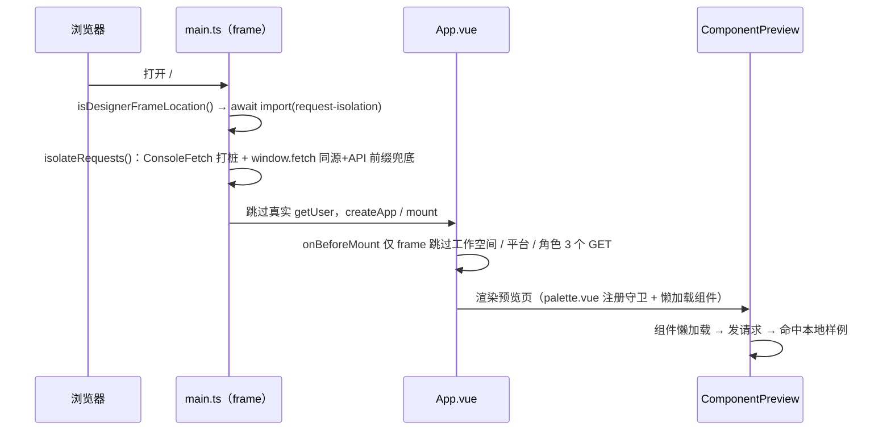

# 主题与组件预览：决策档案 / 踩坑 / 安全评估

> 本文是**归档型文档**：记录为什么这么做、踩过什么坑、安全边界评估过哪些路径。
> 日常执行（改色、跑生成器、同步样例）不要读这里，回到：
> - 主题分层与规约 → [`THEME.md`](./THEME.md)
> - 主题工具链与纪律 → [`../../scripts/theme-codemod/README.md`](../../scripts/theme-codemod/README.md)
> - 可视化与第三方库 → [`THIRD-PARTY-THEME.md`](./THIRD-PARTY-THEME.md)
> - 色板工具与组件预览 → [`../PALETTE.md`](../PALETTE.md)
>
> 2026-11-25 从 `THEME.md`（原第 11、12 章）与 `PALETTE.md`（原第 9 章）迁移而来，**迁移时同步订正**了失效路径与已删除的 `keep` 机制表述。

---

## 一、主题体系关键决策

1. **class 覆写取代编译期替换**（`31dd8251`）：postcss 替换层退役，改生成器产出 `.bkms-themed` 覆写；漂移自检对 `style.variable.css` + `dist/style.css` 双源校验。
2. **uno 令牌扁平注册**（`aa9f621a`）：unocss 按 `-` 切段查 theme，嵌套 key 静默丢弃；`resolveThemeDir()` 用 cwd 优先 + 存在性兜底（unconfig 打包后 `import.meta.url` 指向临时目录）。
3. **级联保护与双源扫描**（`aa9f621a`、`77c7714b`）：覆写规则的全部色彩类声明随行生成；`transparent` / 令牌值命中原值保留；`dist/style.css`（lib/*.less 编译产物）选择器可能更具体，需单独成域复刻。
4. **桥接分域、每域单一聚合入口**（`283c2a0a`）：变量层由 `bkui.ts` 紧随 `style.variable.css` 加载，不走 `index.css`（否则 dev 下 `:root` 后者覆盖）。
5. **产物自举与一次性台账退役**（`9dee3d2b`、`d86a7409`）：`mapping.json` / `keep.json` / `pending-design.json` / 备份文件已退役删除，色值真源收敛到 `color.css` + 产物注释；`keep` 机制改为「命中令牌值即原值保留」自动判定。
6. **规则插件拆分**（`83c86081`）：颜色 / 圆角各成模块，`plugin.mjs` 只聚合；`map.mjs` 与 `uno.config.ts` 同源。
7. **语义层冻结、magicbox 不接入**：`color.css` 的 `@layer semantic` 区不再新增条目，新语义走 uno shortcut 语义类或场景类；`@blueking/magicbox-theme` 架构同构但色板是另一套规范，暂不接入。
8. **viz 域独立**（2026-11-18）：图表 / 编辑器 / 语法高亮不再派生 `--bkms-*`，详见 `THIRD-PARTY-THEME.md`。

## 二、主题体系踩坑清单

| 坑 | 实证 | 结论 |
| --- | --- | --- |
| 生成器清理丢手写补丁 | `cleanGeneratedDir` 曾整目录 `rmSync` | 手写域必须平级分域，清理只删自有 `<kebab>.css` |
| canvas 不解析 `var()` | `597f26b5` minimap `fill` 改 `var()` → `f8e6b7da` 改回实色 | 字典经 var 链解析后必须实色，桥接层负责解析与兜底 |
| `import.meta.url` 指向临时目录 | `aa9f621a` 引入 `resolveThemeDir()` | cwd 优先 + 存在性校验 |
| `.ts` 颜色字符串不在 codemod 台账 | 口径 65 处 `<script>`、明确不含 `.ts` | 记为已知盲区，不假装已全量覆盖 |
| 根 `.gitignore` 的 `*vendor*` | 曾致覆写目录与校验脚本被忽略；两者已改名 `lib` / `check-lib.mjs` 规避 | 新增含 vendor 字样的路径必须 `git status -uall` 复核 |
| markdown 自定义属性 camelCase | `--fgColor-*` 触发 `custom-property-pattern` | 第三方变量名同名重指向，用定点 `stylelint-disable` |
| 业务 scoped 覆盖被覆写层压掉 | `batch-release-progress-panel` 的 `background-image: none`：业务 `[data-v] .bk-step.done .bk-step-number::after` (0,4,0) < `steps.css` `.bkms-themed .bk-steps-primary .bk-step.done .bk-step-indicator:after` (0,5,0) | 覆写层比库原规则多一级 `.bkms-themed`，业务 4 类以内的覆盖由「同分靠顺序」变成「必然输」；`:deep()` 补层级（`.bk-steps.bk-steps-primary .bk-step`）或 `!important` |
| 同元素不同类名致覆盖误判 | bkui Steps 的 `.bk-step-indicator` 与 `.bk-step-number` 是同一个 `span`（`lib/steps/index.js` render） | 排查覆盖失效以 DOM 实际元素为准，不能只比对类名；按类名扫权重会漏这类 |
| 业务覆盖与覆写层平手 | `custom-navigation.vue`（header/container）、`helm-file-list.vue`（tree hover）与 `navigation.css` / `tree.css` 均 4:4 | dev 靠 scoped 后注入取胜，生产打包顺序变化会翻转；值不同的平手项需按需加固 |

## 三、组件预览隔离与安全层

### 3.1 为什么需要边界

组件预览渲染的是真实业务组件：它们会读 Pinia、发 `ConsoleFetch` 请求、弹 Dialog、用第三方库加载资源。若不隔离，预览页会把缺上下文的 4xx/5xx、全局错误提示甚至真实写请求带进主应用会话。因此边界不是「加一层 iframe」就完事，而是**挂载前的时序 + 请求出口 + 渲染兜底**三件事。

### 3.2 三层边界

| 边界 | 实现 | 说明 |
| --- | --- | --- |
| ① iframe realm | `designer-shell.vue`、`palette.vue`、`designer-route.ts` | 父页是外壳，frame 内是完整 App（独立 Pinia / 拦截器 / 模块实例）；`beforeEnter` 阻止 frame 被顶层直接打开；frame 路由组件 `palette.vue` 注册的 `beforeEach` 只放行 `designerFrame`，随组件卸载移除；同源 hash 用 `postMessage` 同步，父页校验 `origin === location.origin`、`source === iframe.contentWindow`、`type === 'palette-query-sync'` |
| ② 请求隔离（挂载前） | `designer-route.ts` → `main.ts:bootstrap()` → `request-isolation.ts` + `fetch-guard.ts` → `App.vue` | 见下方时序；`ConsoleFetch.prototype.request` 打桩 + 原生 `window.fetch` 兜底（**只拦同源 + API 前缀**，跨源与同源静态资源放行）；命中 `api-mock.json` 返回 `structuredClone(sample)`，未命中返回 `[]` |
| ③ 渲染兜底 | `safe-component.ts`、`catalog.ts`、`preview/index.vue` 的 `unmatchedIds` | `onErrorCaptured` 错误边界、异步组件 loading / 错误组件、缺默认导出的可读提示、glob 与清单 mismatch 告警；卸载时还原 appID、ResizeObserver 与 message 监听（请求桩由 `main.ts` 全程持有、故意不还原） |

时序是最关键的一环：`getUser` 和 `App.vue` 的启动期请求都早于任何子组件 setup，把打桩放在预览页组件里已经来不及，所以必须在 `main.ts` 挂载前完成；动态 import 保证 `api-mock.json` 只在 frame 里下载，不进业务首屏。设计器**外壳**（`/#/__designer`）保留完整真实启动期请求（`getUser` + 工作空间 / 平台 / 角色 3 个 GET）：它渲染完整 header（logo / 用户菜单），且 `onBeforeMount` 只在 App 挂载时跑一次，若外壳也跳过，点 logo 或浏览器前进/后退回到业务页后这些请求永不补发（标题不更新、`hasPlatformRole` 恒 false）。

### 3.3 构建期安全

- **产物是可执行 JS**：`catalog.mjs` 用 `value.toString()` 把插件函数（如 `disabledFn`）写进 `component-catalog.js`。在可信仓库里不算漏洞，但它让「只改预览样例」的 PR 具备向生产 bundle 注入 JS 的能力，开源社区贡献场景下应重点 review，并考虑改成声明式数据由渲染层解释。
- **供应链边界**：生成器只在构建阶段跑，生产镜像是 Nginx 静态资源、无 Node 运行时；脚本不联网、不执行子进程、无 `eval` / `new Function`。
- **失败不降级成假成功**：原子写 + 保留上次产物 + 非零退出码，避免空清单 / 半截 JSON 上线。
- **质量护栏**：内容 hash 缓存、`--check` 与 279 个脚本用例接入 `test:ci`、体积预算防 `eager` 回归。

### 3.4 威胁模型澄清（开源项目）

仓库是 MIT 开源 monorepo，后端与 `bkms-server/docs/apis/swagger.yaml` / `swagger.json` 同仓公开，前端 API 类型也由 openapi 生成。因此 `api-mock.json` 的接口 URL 模板、`component-catalog.js` 的组件路径与字段名**都是已公开信息**，打包进 `/assets/*.js` 不构成新增信息泄露。样例值均为占位（无实例数据 / 凭据）。

接口契约公开不代表生产实例的会话与数据边界公开：真实会话 cookie、实例地址、租户数据不在源码中；XSS 影响面与入口边界仍按下表评估。

**已评估过的路径**（只记结论与依据，不写利用步骤，避免后来人重复论证）：

| 路径 | 结论 | 依据 |
| --- | --- | --- |
| 产物里的接口清单 / 组件路径造成信息泄露 | 不成立 | MIT 同仓开源，`bkms-server/docs/apis/swagger.yaml` / `swagger.json` 已公开同样契约；样例值均为占位 |
| 预览页 XSS → 经 `iframe.parent` 拿主站会话 | **不是独立攻击入口** | 项目全局注册 `@blueking/xss-filter`（`v-bk-xss-html`），预览页只渲染静态样例与 URL query、不接真实 API 数据；能在 frame 内执行脚本的前提等价于已能在主站注入 XSS，攻击者无须绕经设计器。缺 CSP / sandbox 只是纵深防御缺口，见 3.5 |
| frame 文档内跳业务页，带空 user / mock 请求跑业务 | 已封堵 | frame 路由组件 `palette.vue` 挂载时注册 `beforeEach`、卸载时移除，只放行 `designerFrame`（覆盖 color / radius / viz / component 全视图）；业务路由模块不感知 |
| 改预览样例夹带 JS 进生产 bundle | 仍成立，属供应链 / 审查面 | `catalog.mjs` 把插件函数体 `toString()` 写进产物，靠 PR review + `test:ci` 约束，不是运行时 XSS |
| 生产直接打开 `/#/__designer` | 仍成立，属治理项 | 无角色 / 开关守卫、hash 路由网关无法按 path 拦截；但预览页只有静态样例、请求被打桩，拿不到真实数据也发不出写请求，不构成数据 / 权限威胁，见 3.5 |

### 3.5 生产现状与待办

| 等级 | 现状 | 建议 |
| --- | --- | --- |
| `[MINOR]`（治理项） | **生产确认保留 designer**；无角色 / 开关守卫，仅依赖 `getUser` 401 的隐含登录态，任何已登录用户可打开。预览页只用静态样例、请求全被打桩，拿不到真实数据也发不出写请求；实际影响是内部工具可见，以及一次访问加载两份 App、多一点带宽与后端读请求，且 hash 路由下网关无法按 path 限流 | 按需加后端下发开关 + 角色守卫，目的是控制谁能用、可一键关闭与限流，不是安全阻断；CSP / HSTS 属全站基线，见 3.4 与 `DEPLOY.md` |
| `[MINOR]` | 同源 iframe 无 `sandbox`、生产无 CSP / HSTS，**但这是纵深防御缺口而非独立攻击链**：项目已全局注册 `@blueking/xss-filter`（`v-bk-xss-html`），预览页只渲染静态样例与 URL query、不接真实 API 数据，能在 frame 内执行脚本的前提等价于已能在主站注入 XSS，攻击者无须绕经设计器；缺这些头只会让「一次已发生的 XSS」可横向触及 `parent` / `localStorage` | 属于全站安全基线：CSP / HSTS 按 `DEPLOY.md` 由网关侧下发；要缩短同源权限需独立 origin iframe（域名 / SSO 配合），与设计器功能无直接依赖 |
| `[MINOR]` | 外壳页保留完整真实启动期请求（`getUser` + 工作空间/平台/角色 3 个 GET，渲染 header 所需、且 `onBeforeMount` 只跑一次不能跳过）；跨源资源（字体 / CDN / 监控）不受打桩约束 | 跨源请求维持放行以保资源加载；外壳真实请求是设计使然，不再评估切假用户 |
| `[MINOR]` | 主入口 11MB 是所有页面共享，设计器首屏无法靠本次懒加载消除 | 预算插件已排除 `isEntry`；彻底解决需独立构建 |
| `[MINOR]` | 守卫放行集合只含 `designerFrame`；将来若把 `paletteViews`（color / radius / viz / component）注册进主 router，`dev/palette/src/App.vue` 会用 `router.replace({ name })` 切视图，`to.name` 变成 `color` 等，`isFrameRoute` 会反过来阻断色板内部切换 | 注册 `paletteViews` 时同步扩展 `isFrameRoute` 放行集合（放行 4 个 palette 视图 + `designerFrame`） |

**与 [`ARCHITECTURE.md`](../ARCHITECTURE.md) 第 3 节的差异**：该节描述的是业务路径（`getUser` → 创建 app → 挂载）；`designerFrame` 是例外分支——挂载前先装隔离、跳过 `getUser`，其余 `import.meta.glob` 模块安装流程一致。
